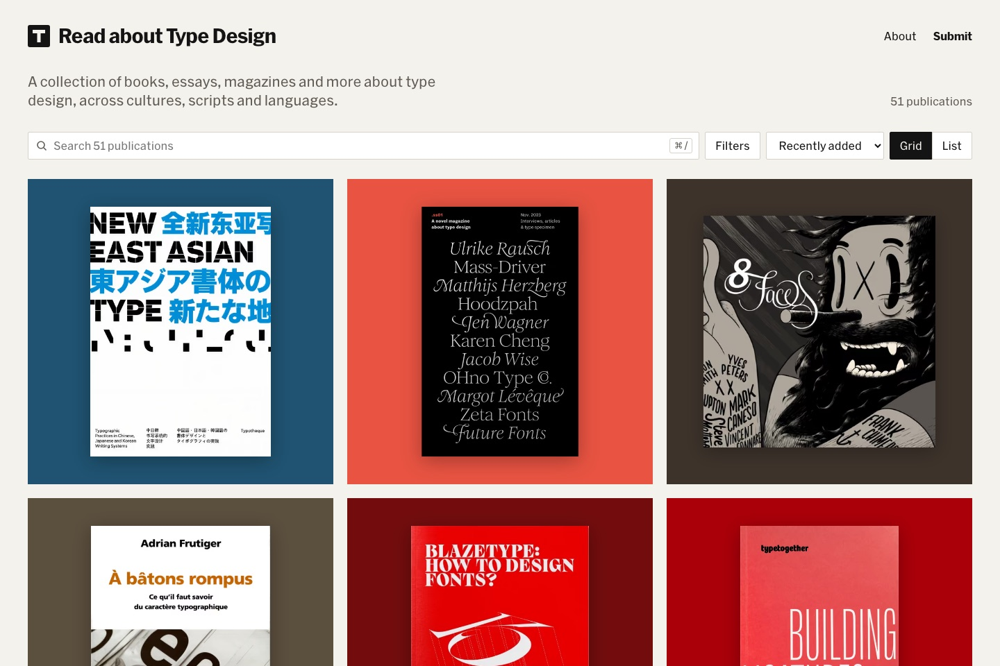
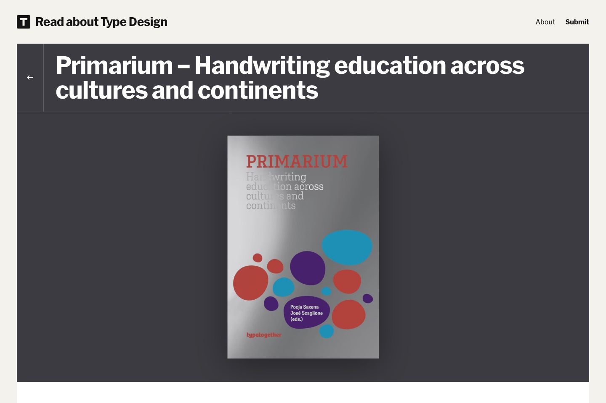
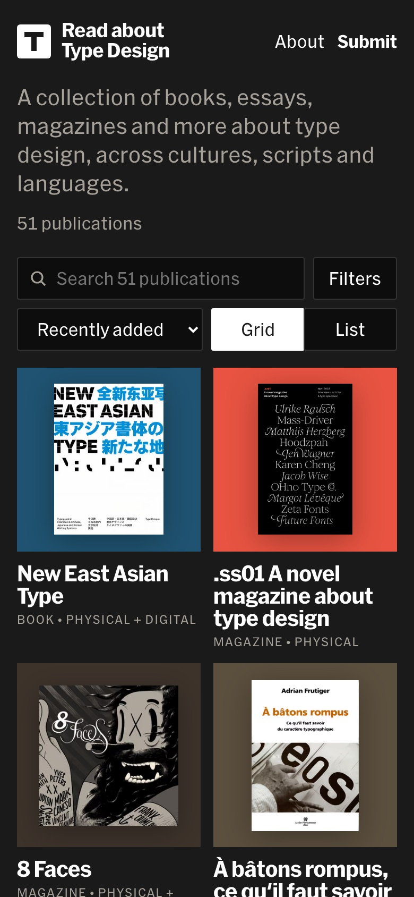

# Read About Type

A curated, open-source library of publications about type design (books, magazines, websites and posts), across cultures, scripts and languages.

> **Status:** Phase 7, QA before launch (2026-11-18). The library, motion, admin (Sveltia CMS) and public submissions are live. Works without JavaScript (except the submission form's spam check); motion is skipped under reduced motion.
> Live: https://typereads.xyz · Repo: https://github.com/guillaumeberry/typereads



## Docs

| #   | Doc                                           | What's inside                                                                                        |
| --- | --------------------------------------------- | ---------------------------------------------------------------------------------------------------- |
| 01  | [Brief](docs/01-brief.md)                     | Vision, audience, goals, non-goals, feedback received, **challenges to the brief**, success criteria |
| 02  | [Functional spec](docs/02-functional-spec.md) | Pages, filters, search, sort, URL state, motion spec, 404 concept, performance budgets, a11y, SEO    |
| 03  | [Content model](docs/03-content-model.md)     | Publication schema, taxonomies (scripts, languages, date ranges), migration from Framer              |
| 04  | [Architecture](docs/04-architecture.md)       | Stack, system diagram, repo structure, CMS, submission pipeline, security                            |
| 05  | [Roadmap](docs/05-roadmap.md)                 | Phases 0–7 with checklists, exit criteria, post-launch backlog                                       |
| 06  | [Decisions](docs/06-decisions.md)             | ADR log: why each choice, alternatives, when to revisit                                              |
| 07  | [Open questions](docs/07-open-questions.md)   | What's still to decide, with defaults                                                                |

## Develop

```bash
npm install
npm run dev      # http://localhost:4321
npm run build    # static site in dist/
npm run check    # type-check
npm test         # unit tests
```

Requires Node 22+. The site's typeface, HEX Franklin, is licensed and not in this repo: put the `.woff2` files in `assets/fonts/`, or set `FONTS_BASE_URL`/`FONTS_TOKEN` to read them from the private fonts repo (see `scripts/fonts.mjs`); otherwise the build falls back to Archivo. Content lives in `src/content/publications/` (one Markdown file per publication); the schema is `src/content.config.ts`.

## Contribute

- **Suggest a publication** with the form at [typereads.xyz/submit](https://typereads.xyz/submit). It lands in the admin's Inbox for review; nothing is published automatically. Your email, if you give it, is only sent to the editor and never stored in this repo.
- **Report a mistake** with the "Suggest a correction" link on any publication page, or open an issue.
- **Code**: pull requests are welcome. Run `npm run format`, then `npm run check`, `npm test` and `npm run build` (CI runs the same). Read [CLAUDE.md](CLAUDE.md) and the [decisions](docs/06-decisions.md) first: the site stays lean, works without JavaScript, and adds no UI framework.
- **Data edits** (a year, a link) can also be a pull request on `src/content/publications/<slug>.md`, following the [content model](docs/03-content-model.md).

<p>
  
  
</p>

Covers in the screenshots are © their publishers, shown to identify each publication.

## TL;DR

- **No database.** ~300 publications = Markdown files in Git. Static site, €0 hosting.
- **Astro** (static) + **one small vanilla TS module** for filters, search, sort and grid/list.
- **Two-tier motion:** a native base (CSS, scroll-driven animations, View Transitions) plus a deferred high-end layer (**GSAP** Flip/SplitText + **Swup** page transitions, ≤ 60 KB) for choreographed, interruptible, cross-browser transitions. **Chosen for now after the motion spike** (variant C, [ADR-012](docs/06-decisions.md#adr-012--two-tier-motion-architecture-native-base--gsap-layer--swup-router)); native-only (A) is the fallback until phones are tested.
- **Cloudflare** hosts the site and its Worker (submissions, `/api/*` only), the CMS login Worker and the Turnstile spam check. **Resend** sends the email alerts. All on free tiers.
- **Sveltia CMS** at `/admin`, with GitHub login (2FA). Edits are commits; the site rebuilds in about 1–2 minutes.
- **Submissions**: on-site form → Worker → `status: submitted` entry in the CMS Inbox, plus an email to the editor. Submitter emails never touch the public repo.
- **Cabin** analytics (cookie-free, no consent banner).
- **Licences**: MIT code · CC BY 4.0 data · covers © publishers. The motion layer uses [GSAP](https://gsap.com), installed from npm under its own free but proprietary _Standard No Charge_ licence (not open source); it is not part of this repo's MIT code.

## Folder

```
typereads/
├── README.md        ← you are here
├── CLAUDE.md        ← guidance for Claude sessions
├── docs/            ← planning docs (above)
├── src/             ← Astro site: content/, content.config.ts, data/, lib/, pages/, scripts/
├── public/admin/    ← Sveltia CMS (config.yml mirrors the schema); public/_headers: CSP
├── worker/          ← the site's Worker: POST /api/submit (Turnstile → GitHub → email)
├── scripts/         ← build helpers: fonts.mjs (licensed fonts), csp.mjs (CSP check)
├── LICENSE          ← MIT (code) · LICENSE-CONTENT.md: CC BY 4.0 (data), covers excluded
└── assets/fonts/    ← licensed typefaces, gitignored (never committed)
```
