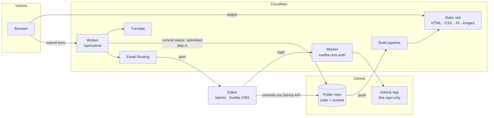
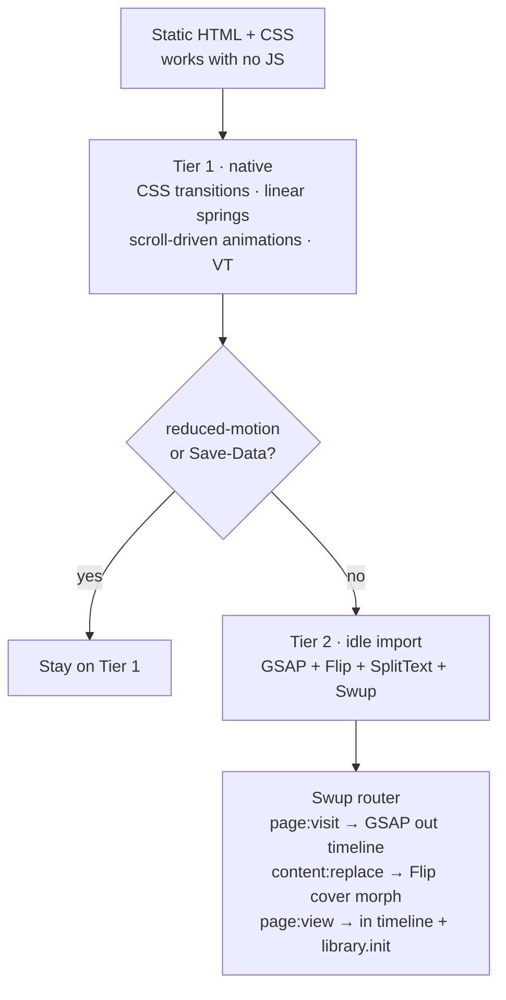
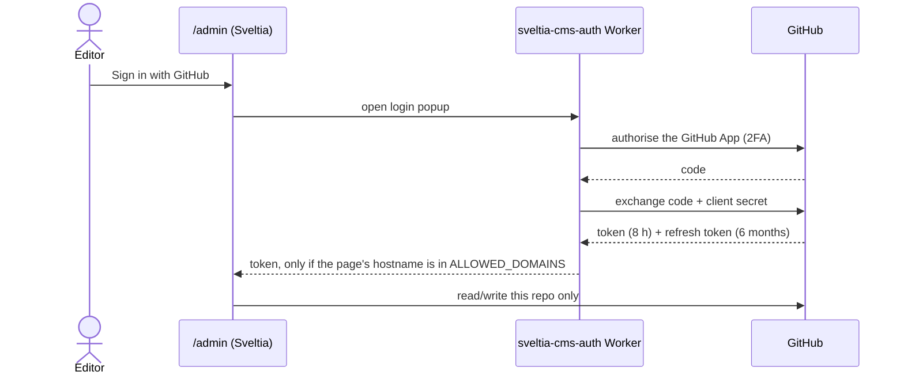
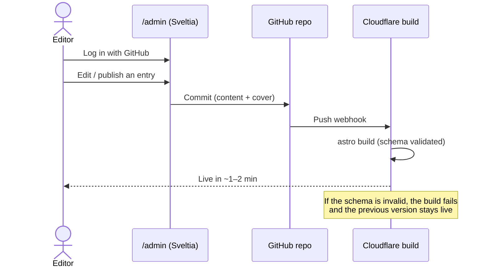
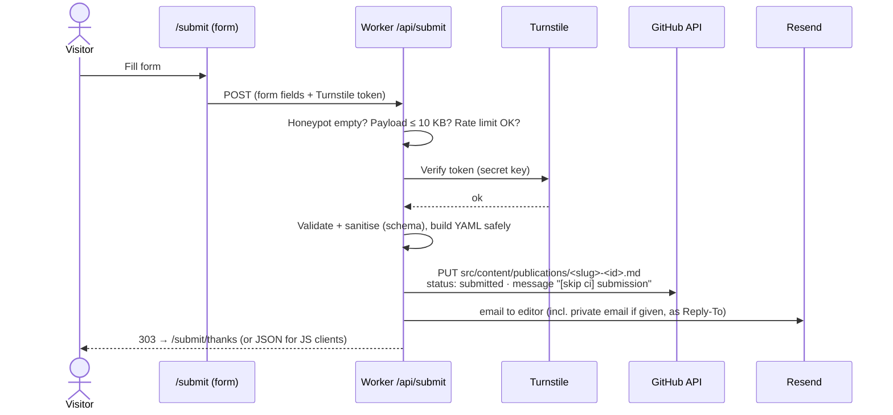

# 04 — Architecture and tech stack

> Status: draft · Last updated: 2026-11-14
> The reasoning behind each choice is in [06 — Decisions](06-decisions.md).

## The stack at a glance

| Layer                     | Choice                                                                             | Why (short)                                                                                                                                  | Cost                |
| ------------------------- | ---------------------------------------------------------------------------------- | -------------------------------------------------------------------------------------------------------------------------------------------- | ------------------- |
| Site framework            | **Astro** (static output)                                                          | Ships zero JS by default, typed content collections, built-in image optimisation, native view-transition support, very good docs.            | Free, MIT           |
| Content storage           | **Markdown + YAML in the Git repo**                                                | No database to run; versioned, diffable and backed up by Git.                                                                                | Free                |
| Client interactivity      | **Vanilla TypeScript** (one small module)                                          | Filtering, search, sort and view toggle over server-rendered HTML. No UI framework.                                                          | ≤ 15 KB             |
| Motion: base (Tier 1)     | **CSS + scroll-driven animations + View Transitions**                              | Native, off the main thread, always on.                                                                                                      | 0 KB                |
| Motion: high-end (Tier 2) | **GSAP** (core + Flip + SplitText)                                                 | Choreographed, interruptible, cross-browser layout morphs and type animation. All plugins free since 2025 (proprietary "no charge" licence). | ~35 KB, deferred    |
| Page transitions          | **Swup** (`@swup/astro`) + JS-animation, preload and scroll plugins                | GSAP timelines on the live DOM of both pages; works in Firefox; persistent header.                                                           | ~10–15 KB, deferred |
| Hosting                   | **Cloudflare** (static assets + Workers)                                           | Free, unmetered static bandwidth, global CDN; the same platform runs the CMS login, the submit endpoint and anti-spam.                       | Free                |
| Backend / CMS             | **Sveltia CMS** (Git-based, Decap-compatible)                                      | A static admin app at `/admin`. Commits directly to the repo. Modern, fast, mobile-friendly.                                                 | Free, MIT           |
| CMS login                 | **GitHub App** (installed on this repo only) via the **`sveltia-cms-auth` Worker** | No passwords stored by us. Access = write access to the repo, protected by GitHub 2FA.                                                       | Free                |
| Submissions               | **Cloudflare Worker** `/api/submit` + **Turnstile**                                | Validates and writes a `status: submitted` entry to the repo, then emails the editor.                                                        | Free                |
| Notifications             | Resend, free tier (HTTP API from the Worker)                                       | Submission alerts in your inbox.                                                                                                             | Free                |
| Analytics                 | **Cabin** (fallback: Cloudflare Web Analytics)                                     | Cookie-free, low-carbon; no consent banner needed.                                                                                           | Free ≤ 10k pv/mo    |
| Code hosting / CI         | **GitHub** (public repo)                                                           | Open source; Cloudflare builds on push.                                                                                                      | Free                |
| Dependency updates        | Renovate or Dependabot                                                             | Keeps a small dependency list patched.                                                                                                       | Free                |

**Running cost: €0/month.** Optional later: a domain, about €10–15 a year.

## System overview



## Repository structure (planned)

```
typereads/   (github.com/guillaumeberry/typereads)
├── README.md                    # what it is, how to run, licences
├── LICENSE                      # MIT (code)
├── LICENSE-CONTENT.md           # CC BY 4.0 (metadata/descriptions); covers excluded
├── CLAUDE.md                    # guidance for Claude sessions
├── docs/                        # ← these planning docs
├── astro.config.mjs
├── package.json
├── public/
│   ├── admin/
│   │   ├── index.html           # loads Sveltia CMS
│   │   └── config.yml           # CMS collections & fields
│   ├── fonts/                   # WOFF2 (only if licence allows a public repo — see Q2)
│   ├── _headers                 # security headers (CSP etc.)
│   └── robots.txt
├── src/
│   ├── content.config.ts        # Zod schema (source of truth for validation)
│   ├── content/
│   │   ├── publications/
│   │   │   ├── manual-of-diacritics.md
│   │   │   └── covers/manual-of-diacritics.jpg
│   │   └── pages/about.md
│   ├── data/
│   │   ├── taxonomies.ts        # types, scripts, availability, date buckets
│   │   └── site.json
│   ├── layouts/Base.astro
│   ├── components/              # Card, CardList, FilterPanel, Toolbar, CoverFallback…
│   ├── pages/
│   │   ├── index.astro
│   │   ├── publications/[slug].astro
│   │   ├── about.astro
│   │   ├── submit.astro
│   │   ├── submit/thanks.astro
│   │   └── 404.astro
│   ├── scripts/
│   │   ├── library.ts           # filter/search/sort/view engine (core, ≤ 15 KB)
│   │   └── motion/              # Tier 2, lazy-loaded: swup setup, page timelines,
│   │       ├── router.ts        #   Flip helpers, SplitText reveals, sheet drag
│   │       ├── transitions.ts
│   │       └── flip.ts
│   ├── styles/
│   │   ├── tokens.css           # colours, type scale, spacing, motion tokens
│   │   └── global.css
│   └── lib/
│       ├── color.ts             # cover colour extraction + contrast
│       └── normalize.ts         # accent-insensitive search text
├── workers/
│   └── (see worker/index.ts)    # the site's Worker: /api/submit
│       ├── src/index.ts
│       └── wrangler.toml
└── scripts/
    └── import-framer.ts         # one-off migration
```

## Front-end architecture

### Rendering

- `astro build` with `output: 'static'`. Every page is plain HTML at build time.
- `getCollection('publications', p => p.data.status === 'published')` drives the home page, detail pages, sitemap and counts.
- Images go through `astro:assets` (`<Image>`/`<Picture>`) to produce AVIF/WebP at several widths.

### The library engine (`src/scripts/library.ts`)

Approach: **filter the DOM, don't re-render it.**

1. Each card is rendered with its facets as data attributes:
   `<li data-type="book" data-formats="physical" data-langs="en fr" data-scripts="Latn" data-year="2021" data-bucket="2020s" data-avail="in-print" data-added="2024-03-02" data-search="manual of diacritics radek sidun…">`
2. On load: read the URL params, apply them, then compute the faceted counts.
3. On change: compute the visible set as a pure function of (state, items). Inside `document.startViewTransition()`, toggle `hidden` on the cards, reorder the nodes for sort, and update the counts and URL.
4. View toggle: switch a class on the list container (`.is-grid`/`.is-list`) inside a view transition, and save it to `localStorage`.

Why this works: 300 nodes is trivial for the DOM, there's no JSON fetch, SEO and no-JS work out of the box, and the state logic is a pure, unit-testable function.

**Scaling escape hatch:** above ~1,500 items, switch the home page to a JSON index with windowed rendering, or to Pagefind (static search with filter support). This isn't needed for the target scale.

### Motion architecture (two tiers, [ADR-012](06-decisions.md#adr-012--two-tier-motion-architecture-native-base--gsap-layer--swup-router))



- **Loading:** `library.ts` loads normally. `motion/router.ts` loads with a dynamic `import()` on `requestIdleCallback` after first paint, only when `matchMedia('(prefers-reduced-motion: reduce)')` is false and Save-Data is off. Until it loads, links navigate normally (Tier 1).
- **Swup:** container `#swup` wraps `<main>`, so the header and footer persist. Plugins: JS animations (GSAP timelines per route pair: library→detail, detail→library, default), preload (hover/touchstart), scroll (restore position on Back), head (update `<title>`/meta), and optionally fragment, to swap only the results list on filter URLs.
- **Card → detail morph** (as proven in the spike's variant C): when the visit starts, clone the clicked cover into a fixed-position "ghost" outside `#swup` and hide the original; other cards leave in a ripple stagger. After `content:replace`, fly the ghost onto the hero's rect (transform only), reveal the detail with a `clip-path: circle()` colour flood from the ghost's centre, and reveal the title with SplitText lines. **Back:** before the content is replaced, keep the detail colour as a full-screen overlay, then shrink it into the card while the ghost flies back. The slug comes from the URLs, so both directions find the right card.
- **Lessons from the spike** (carry into Phase 4):
  - **Flip only cards in or near the viewport** (±200 px, max 40) and let the rest snap. Measuring all 50 cards and covers caused a 100 ms+ frame on grid ↔ list.
  - Call `Flip.getState()` → mutate the DOM → `kill()` the running flip → `Flip.from()`. That order kept rapid filter taps clean (no leftover inline position, size or opacity).
  - **One click handler per link.** Anything that calls `history.back()` (the "← Library" link) must also be excluded from Swup via `ignoreVisit`, or Swup pushes a new entry first and Back undoes it (the double-click bug).
  - Run a `cleanup()` on `visit:abort` and at the end of every _in_ animation: kill timelines, remove the ghost and overlay, clear inline opacity/transform/clip-path.
  - In-page transitions use an injected strategy (`initLibrary(root, animate)`): Tier 1 passes a View Transitions strategy, Tier 2 swaps in Flip once loaded, so the library engine doesn't care which tier is active.
  - Watch on phones: one long frame at the start of each transition (layout measurement), worst on grid ↔ list mid-scroll (~50 ms on desktop).
- **Script lifecycle:** every module exposes `init(root)` / `destroy()`, called on `page:view` / `visit:start`, so filters, sheets and observers don't leak between pages.
- **Lazy-loading GSAP plugins:** Flip and SplitText load with the router; ScrollTrigger/Observer are imported only on pages that use them.

### View transitions (Tier 1 fallback)

- Global CSS: `@view-transition { navigation: auto; }` enables cross-document transitions in Chrome, Edge and Safari.
- Shared element: `view-transition-name: cover-<slug>` on the card cover _and_ the detail hero image. Only one element per page may have a given name, which is satisfied here.
- Filtering: give each card its own `view-transition-name` (e.g. `card-<slug>`) only while a transition is running, to keep normal rendering cheap.
- `@media (prefers-reduced-motion: reduce)` sets `::view-transition-group(*)` animation to none, or a short crossfade.

### Prefetch / prerender

With Tier 2: Swup's preload plugin fetches pages on hover/touchstart. Native-only fallback (if the spike drops Swup): the Speculation Rules API, with a `<script type="speculationrules">` that prerenders `/publications/*` at `moderate` eagerness. Browsers without support ignore it.

## Backend (CMS)

**Sveltia CMS** is a single-page admin app served from `/admin`. It talks to GitHub's API directly from the browser, so there is no server of ours in the middle except the tiny login Worker.

### Access and security

The `/admin` page is public static HTML, but useless without a login: nothing can be saved without a GitHub account that can write to the repo. Today that means only you. Details and the alternatives are in [ADR-004](06-decisions.md#adr-004--sveltia-cms-git-based-as-the-backend).



| Layer                    | Setting                                                                                                                                                 |
| ------------------------ | ------------------------------------------------------------------------------------------------------------------------------------------------------- |
| Who can save             | GitHub accounts with write access to the repo (only you).                                                                                               |
| What the token can reach | **This repo only**: a GitHub App installed on one repo, with Contents read/write and Metadata read. Not an OAuth app, which would reach all your repos. |
| Login Worker             | `GITHUB_CLIENT_SECRET` as a Worker secret; `ALLOWED_DOMAINS` = the site's hostname; token expiry on.                                                    |
| Your GitHub account      | 2FA with a passkey or hardware key.                                                                                                                     |
| Token in the browser     | Stored in `localStorage`; protected by the site-wide CSP (only first-party scripts and Cabin).                                                          |
| Optional                 | Cloudflare Access on `/admin*` (free), so strangers can't even load the admin.                                                                          |
| Simpler alternative      | Fine-grained personal access token (this repo, Contents read/write, expiry) with _Sign in with Token_: no Worker, manual rotation.                      |

### Collections (sketch of `public/admin/config.yml`)

```yaml
backend:
  name: github
  repo: guillaumeberry/typereads
  branch: main
  base_url: https://sveltia-cms-auth.<account>.workers.dev

collections:
  - name: inbox
    label: Inbox (submissions)
    folder: src/content/publications
    filter: { field: status, value: submitted }
    create: false
    fields: &publication_fields
      - { name: title, label: Title, widget: string }
      - {
          name: status,
          label: Status,
          widget: select,
          options: [submitted, draft, published],
          default: draft,
        }
      - { name: type, label: Type, widget: select, options: [book, magazine, web] }
      - { name: authors, label: Authors, widget: list }
      - {
          name: scripts,
          label: Scripts covered,
          widget: select,
          multiple: true,
          options: [Latn, Cyrl, Grek, Arab, …],
        }
      # … all fields from docs/03-content-model.md
      - { name: body, label: Description, widget: markdown }

  - name: publications
    label: Publications
    folder: src/content/publications
    create: true
    slug: '{{slug}}'
    media_folder: covers
    public_folder: ./covers
    fields: *publication_fields

  - name: pages
    label: Pages
    files:
      - { name: about, label: About, file: src/content/pages/about.md, fields: [...] }
```

> Check during Phase 5: Sveltia's support for `filter` on folder collections, YAML anchors and entry-relative media folders. If any of these is missing, either use plain repeated field lists, or fall back to **Decap CMS** (same config format, older UI).

### Editing flow



## Submission pipeline



### Details

- **Hosting**: the site's own Worker (`worker/index.ts`); `run_worker_first: ["/api/*"]` in `wrangler.jsonc` keeps every other request on static assets. Secrets: `TURNSTILE_SECRET`, `GITHUB_TOKEN`, `RESEND_API_KEY`, `NOTIFY_TO` (dashboard only). Local testing: `.dev.vars` with Turnstile's test secret and `DRY_RUN=1`, then `npx wrangler dev`.
- **GitHub token**: a **fine-grained personal access token** (or a GitHub App) scoped to **this repo only**, with **Contents: read & write** only and an expiry date. Stored as a Worker secret. Rotate it yearly.
- **Write format**: the YAML is generated with a serialiser (e.g. `yaml` npm), never by string concatenation, so it can't be injected. The body is plain text, escaped.
- **`[skip ci]`** in the commit message: Cloudflare doesn't rebuild for submissions, because they aren't published anyway. The next real edit rebuilds as usual.
- **Rate limiting**: the Workers rate-limiting binding `SUBMIT_LIMIT` (5 per 60 s per IP, per Cloudflare location). A WAF rule can be added on top.
- **Privacy**: the submitter's email is **only** in the notification email. It's never written to the repo or logged. A credit name is only written when consent is ticked.
- **Spam fallback**: if spam ever gets past Turnstile, the Worker can write to a private store (Cloudflare KV/D1) instead of the repo, with an "accept" button that commits. That's deliberately not built in V1.

## Security checklist

| Risk                               | Mitigation                                                                                                                                                                             |
| ---------------------------------- | -------------------------------------------------------------------------------------------------------------------------------------------------------------------------------------- |
| Account takeover of the backend    | GitHub 2FA (passkey); access = repo write permission; GitHub App limited to this repo; `ALLOWED_DOMAINS` on the login Worker; token expiry on; optional Cloudflare Access on `/admin`. |
| Token theft from the browser (XSS) | Sveltia keeps the token in `localStorage`: strict CSP, no third-party scripts except Cabin, no raw HTML rendered from content.                                                         |
| Leaked secrets                     | All secrets are Worker secrets; `.dev.vars` is git-ignored; GitHub secret scanning is on.                                                                                              |
| Over-privileged token              | Fine-grained token: one repo, contents only, with an expiry.                                                                                                                           |
| Spam / abuse of the form           | Turnstile + honeypot + rate limit + size limit + server-side validation.                                                                                                               |
| XSS via content                    | Markdown rendered without raw HTML; URLs validated (`https:` only); a strict CSP in `_headers`.                                                                                        |
| Personal data in a public repo     | No emails stored; opt-in credits; no internal notes in front matter.                                                                                                                   |
| Supply chain                       | Few dependencies; lockfile committed; Renovate/Dependabot; `npm audit` in CI.                                                                                                          |
| Bad data breaking the site         | Zod schema validation fails the build and keeps the last good deploy live.                                                                                                             |

### Security headers (`public/_headers`)

```
/*
  Content-Security-Policy: default-src 'self'; img-src 'self' data:; script-src 'self' https://challenges.cloudflare.com <cabin-domain>; frame-src https://challenges.cloudflare.com; connect-src 'self' <cabin-domain>; style-src 'self' 'unsafe-inline'; base-uri 'self'; form-action 'self'
  Referrer-Policy: strict-origin-when-cross-origin
  X-Content-Type-Options: nosniff
  Permissions-Policy: camera=(), microphone=(), geolocation=()
/admin/*
  # Sveltia needs the GitHub API (api.github.com), its own script and the login Worker's popup;
  # use a separate CSP here, following Sveltia's CSP docs
```

The exact CSP gets tuned during implementation; Astro inline scripts may need hashes.

## Environments

| Env        | URL                                                                        | Trigger                            |
| ---------- | -------------------------------------------------------------------------- | ---------------------------------- |
| Local      | `localhost:4321`                                                           | `npm run dev`                      |
| Preview    | Workers Builds preview URL per branch / PR                                 | Push to any branch or PR           |
| Production | `typereads.xyz` (and `www.`; also `typereads.guillaume-berry.workers.dev`) | Push to `main` (incl. CMS commits) |

Builds: ~300 entries with images, an estimated 1–2 minutes. Astro caches optimised images between builds where the platform allows. The free tier allows 500 builds/month, far beyond monthly updates.

## Why not … (short)

| Option                                            | Why not (for this project)                                                                                                                                                                                                                                                                                                                                                                     |
| ------------------------------------------------- | ---------------------------------------------------------------------------------------------------------------------------------------------------------------------------------------------------------------------------------------------------------------------------------------------------------------------------------------------------------------------------------------------- |
| A database (Supabase, Turso, D1, Airtable)        | Not needed at 300 items; adds a runtime, credentials and failure modes. See ADR-001.                                                                                                                                                                                                                                                                                                           |
| Next.js / Nuxt / SvelteKit                        | Heavier runtime JS by default and server-oriented; overkill for a static catalogue.                                                                                                                                                                                                                                                                                                            |
| Eleventy                                          | Leaner still, but you'd hand-build the image pipeline, typed content validation and view-transition setup. Astro gives these out of the box with similar output weight.                                                                                                                                                                                                                        |
| Headless SaaS CMS (Sanity, Contentful, Storyblok) | Free tiers change, there's vendor lock-in, and it needs build webhooks and API keys. Git is enough for one editor.                                                                                                                                                                                                                                                                             |
| Keystatic                                         | A good Git-based CMS, but its GitHub mode needs server routes (SSR adapter), which adds moving parts. Sveltia is fully static.                                                                                                                                                                                                                                                                 |
| Pages CMS (hosted)                                | Zero setup, but a third-party service gets write access to your repo. A reasonable fallback if Sveltia setup is painful.                                                                                                                                                                                                                                                                       |
| Vercel / Netlify                                  | Vercel's free tier is non-commercial only. Netlify's Free plan is a 300-credit monthly cap (deploys and bandwidth count) that takes every site offline when reached, and Git Gateway (Decap's Netlify bridge) is deprecated; details in [ADR-003](06-decisions.md#adr-003--cloudflare-for-hosting-and-serverless-pieces). Cloudflare is unmetered for static assets and hosts the Workers too. |
| Motion (motion.dev)                               | MIT and great springs, but automatic layout animations are React-only; we're vanilla. GSAP Flip covers that.                                                                                                                                                                                                                                                                                   |
| Barba.js                                          | Comparable to Swup, but no official Astro integration.                                                                                                                                                                                                                                                                                                                                         |
| Astro `<ClientRouter />`                          | Zero extra dependencies and cross-browser, but still snapshot-based VT, so it's limited for choreographed and interruptible motion. The middle option if the spike rejects Swup.                                                                                                                                                                                                               |
| WebGL (three.js/OGL)                              | 30–150 KB and GPU cost for effects outside the brand's needs in V1.                                                                                                                                                                                                                                                                                                                            |
