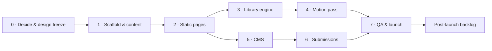

# 05 — Roadmap

> Status: draft · Last updated: 2026-11-14
> Sizes: **S** ≈ one working session · **M** ≈ 2–3 sessions · **L** ≈ a week of evenings. These assume Guillaume + Claude; adjust as you learn your own pace.

## Overview

Phases 4 (motion) and 5–6 (backend) can run in parallel once Phase 2 is done.

---

## Phase 0 — Decide and freeze the design · **M**

Goal: no open question blocks the build, and there is one design reference.

- [ ] Answer the blocking [open questions](07-open-questions.md): Q1 (Figma), Q2 (fonts), ~~Q3 (GitHub repo)~~ answered: `guillaumeberry/typereads`, Q5 (date ranges).
- [ ] Merge the Figma and Framer screens into **one Figma page** of final screens:
  - Home: grid, list, filters open (desktop panel + mobile sheet), empty state, search with results
  - Detail: with cover, without cover (typographic fallback), long title, many translations
  - About, Submit (form, errors, thanks, correction mode), 404
  - Mobile versions of everything
- [ ] Define the design tokens in Figma variables: colours, type scale, spacing, radii, motion durations and easing.
- [ ] Storyboard the 3 signature motions (card → detail, filtering, grid ↔ list). A Framer prototype or a short screen recording is enough. Collect 2–3 reference sites for the level of motion you want ([Q15](07-open-questions.md)).
- [ ] **Motion spike** (throwaway, ~2 sessions). Build the 3 signature motions with 50 real covers, three ways: **A** native VT only · **B** Astro ClientRouter · **C** Swup + GSAP Flip/SplitText. Test on a mid-range Android phone, an iPhone, and desktop Chrome, Safari and Firefox. Measure fps, INP and JS weight, and judge the feel. Confirm or amend [ADR-012](06-decisions.md#adr-012--two-tier-motion-architecture-native-base--gsap-layer--swup-router).
  - [x] Built in [`spike/motion/`](../spike/motion/README.md); desktop Chrome baseline measured; B and C performance fixes applied.
  - [x] **Decision (2026-11-15): C (Swup + GSAP) for now**, A (native) as the fallback, B dropped. Pros and cons in ADR-012.
  - [ ] Device tests (mid-range Android, iPhone, Safari, Firefox) and the scorecard. They can still switch the decision to A.
- [x] GitHub repo created: [guillaumeberry/typereads](https://github.com/guillaumeberry/typereads) (2026-11-17).
- [ ] Turn on GitHub 2FA (passkey preferred) and create a Cloudflare account.

**Exit:** the design is frozen enough to build; accounts exist.

## Phase 1 — Scaffold and content · **M**

Goal: a repo with valid content and nothing visual yet.

- [x] Astro project (7.4.12, TypeScript strict), Prettier, and CI (format check, type-check, build on push and PR). _(2026-11-17)_
- [x] `LICENSE` (MIT), `LICENSE-CONTENT.md`, README, `CLAUDE.md`. _(2026-11-17)_
- [x] Write `src/content.config.ts` (Zod schema from [03](03-content-model.md), with ISBN/ISSN checksums; `''`/`null` count as missing) and `src/data/taxonomies.ts`. _(2026-11-17)_
- [x] Import the 50 entries: done from the spike's data (scraped from the Framer prototype), including your enrichment of _8 Faces_ and _Cyrillize it!_. _(2026-11-17)_
- [x] Covers downloaded next to the entries (`src/content/publications/covers/`, 50 files, 6.7 MB); the schema now requires local files. _(2026-11-17)_
- [ ] Optional: export the Framer CMS to CSV and compare, in case it holds fields the scrape missed (languages?).
- [ ] Enrich the data by hand: `scripts`, `availability`, missing languages and descriptions. Fix typos. Then set `REQUIRE_ENRICHMENT = true` in `src/content.config.ts`. (Languages for 13 more entries and 2 translations were taken from the prototype's detail pages on 2026-11-17: 17 of 50 now have languages.)
- [x] Connect the repo to Cloudflare (Workers Builds, `wrangler.jsonc`). Live: <https://typereads.guillaume-berry.workers.dev>, every push to `main` deploys. _(2026-11-17)_

**Exit:** `npm run build` is green with 50 valid publications, and a preview URL is live.

## Phase 2 — Static pages · **L**

Goal: the full site works with zero JS.

- [x] Tokens and global CSS (`src/styles/global.css`); fonts self-hosted (Archivo + Archivo Narrow, OFL, 47 KB in 2 files, interim until Q2). _(2026-11-17)_
- [x] `Base` layout: header, footer, skip link, meta/OG, JSON-LD. _(2026-11-17)_
- [x] Home: server-rendered grid of cards with data attributes, sorted by `addedAt`. _(2026-11-17)_
- [x] Card component with `<Picture>` (AVIF/WebP), per-publication colour background, lazy loading, first-row priority. _(2026-11-17)_
- [x] Contrast helper (`src/lib/color.ts`). _(2026-11-17)_
- [ ] Colour extraction from the cover when `color` is empty (all 50 have a colour today; needed for new entries).
- [x] Detail page: hero, metadata grid, links, description, JSON-LD, typographic cover fallback. _(2026-11-17)_
- [x] About page from `src/content/pages/about.md` (FAQ as structured fields rendered with `
`); copy migrated from the prototype, typos fixed, colophon updated. _(2026-11-17)_
- [x] Submit page (form markup posting to `/api/submit`, sending disabled until Phase 6) and the thanks page. _(2026-11-17)_
- [x] 404 page, static ".notdef" version with _Read something random_. _(2026-11-17)_
- [x] Sitemap, robots, canonical URLs (clean URLs: pages built as `about.html`, served at `/about`). _(2026-11-17)_
- [x] Checked: Lighthouse mobile 100/100/100/100 on home, a detail page and About; home has no JS, 11.8 KB HTML and 2 KB CSS gzipped. _(2026-11-17)_

**Exit:** the site is browsable and responsive on mobile and desktop with JS disabled; Lighthouse ≥ 95 already.

## Phase 3 — Library engine · **M**

Goal: filters, search, sort and view toggle, all reflected in the URL.

- [x] `src/scripts/library-core.ts`: pure `computeVisible` / `computeCounts` / sort / URL state, with 15 Vitest tests (`npm test`, also in CI); `library.ts` wires the DOM with `init`/`destroy` and an `animate` hook for Phase 4. _(2026-11-17)_
- [x] URL ↔ state sync (`replaceState` for typing, `pushState` for filter changes); back/forward support. _(2026-11-17)_
- [x] Filter panel (desktop: non-modal `<dialog>` under the toolbar; mobile: modal bottom sheet with _Show N results_) with faceted counts and disabled zero-result options. Only values present in the data are offered. _(2026-11-17)_
- [x] Language filter with _Include translations_; script chips with glyphs; date presets; availability (hidden while every entry is `unknown`). _(2026-11-17)_
- [x] Accent-insensitive, multi-word search with debounce, `/` and `Esc`. Descriptions load from `/search.json` (1.6 KB gz) on first focus. _(2026-11-17)_
- [x] Sort menu with the 4 options. _(2026-11-17)_
- [x] Grid/list toggle, persisted in `localStorage` (`rat:view`, applied before first paint). List view built from the Q4 default: title · authors · year · type · languages · format; two lines on mobile. _(2026-11-17)_
- [x] Active-filter chips, _Reset_, live result count (`aria-live`), empty state. _(2026-11-17)_
- [x] Page is bfcache-eligible (Lighthouse audit passes); scroll restoration is the browser's own. Not yet checked by hand on a phone. _(2026-11-17)_
- [x] Measured: library JS 3.1 KB gz (budget 15); Lighthouse mobile 99/100/100/100; works without JS (controls hidden, full grid). _(2026-11-17)_
- [ ] **Watch:** home HTML is 16.9 KB gz for 50 entries, about 85 KB at 300 (budget 60), mostly image `srcset`s. Options when it matters: fewer image widths, or render the first N cards and the rest from JSON.

**Exit:** every filter combination works, is shareable by URL and survives back/forward; core JS ≤ 15 KB gz (motion layer excluded).

## Phase 4 — Motion pass · **M**

Goal: the high-end part: native base plus the GSAP/Swup layer (C, chosen in the spike; see the lessons in [04 · Motion architecture](04-architecture.md#motion-architecture-two-tiers-adr-012)).

- [x] Tier 1: motion tokens, `linear()` springs, CSS scroll-driven tile reveals and detail-cover parallax, native cross-document VT (page cross-fade, header stays) and same-document VT for filtering (`src/scripts/vt.ts`). _(2026-11-17)_ The native _cover morph_ between pages was left out: Tier 2 loads within a second or two, and reduced-motion visitors get no morph anyway.
- [x] Tier 2 loader in `src/scripts/boot.ts`: idle dynamic import, skipped under reduced motion or Save-Data; `mount`/`unmount` for page scripts (library, 404). _(2026-11-17)_
- [x] Swup setup (`src/scripts/motion/index.ts`): `#main` container, persistent header and footer, preload on hover, scroll restoration, head plugin (titles, canonical, JSON-LD, page CSS). Back/forward between filter states stays with the library. _(2026-11-17)_
- [x] Signature: card → detail cover flight (a copy of the cover image) + clip-path colour flood from the cover + SplitText title, with an exact reverse on Back (colour shrinks into the card, cover lands on it, focus returns to it). Measured: the cover lands on the hero and back on the card to the pixel. _(2026-11-17)_
- [x] Filtering, sort and search with Flip (viewport cards only, interruptible); grid ↔ list nested Flip. _(2026-11-17)_
- [ ] Type moments: variable-axis wordmark (waits for the font, Q2). Title line reveal on detail pages is done.
- [x] Micro-interactions: card hover spring, filter chips, draggable mobile sheet (drag down to dismiss), rolling result count. _(2026-11-17)_ Pointer tilt left out (optional).
- [x] 404: the numeral cycle (404 → ٤٠٤ → ४०४ → ৪০৪ → ๔๐๔ → ༤༠༤ → ☐☐☐) and _Read something random_. _(2026-11-17)_
- [x] Audit, automated: focus moves to the new page's heading (or back to the card), page changes are announced, the header's current-page marker updates, interrupted transitions leave nothing behind; Lighthouse mobile 99–100; core JS 4.8 KB, motion layer 56.4 KB gz. _(2026-11-17)_
- [ ] Audit, by hand: fps on a mid-range Android phone, iOS Safari (incl. swipe-back), desktop Safari and Firefox, and reduced motion turned on in the OS.

**Exit:** the motion matches the storyboard in **all** browsers; 60 fps on a mid-range Android phone; INP < 150 ms; motion layer ≤ 60 KB gz.

### Design updates (2026-11-17)

- [x] Light theme by default; dark follows the system preference (A12).
- [x] HEX Franklin (licensed) via `scripts/fonts.mjs`, Archivo fallback (A11). Lighthouse light mode: accessibility 100, no contrast issues.
- [x] Private repo `guillaumeberry/typereads-fonts` with the two files; `scripts/fonts.mjs` downloads them through the GitHub API (tested: byte-identical files; wrong token → fallback, or build failure with `FONTS_REQUIRED=1`). _(2026-11-17)_
- [ ] Fine-grained token (Contents: read-only on `typereads-fonts`, with an expiry) and Cloudflare build variables `FONTS_BASE_URL`, `FONTS_TOKEN` (secret), `FONTS_REQUIRED=1`. Set a reminder to renew the token before it expires: deploys fail (and the previous version stays live) once it does.

## Phase 5 — Backend (CMS) · **M**

Goal: Guillaume edits content from `/admin` with GitHub login.

- [ ] Create a **GitHub App** installed on this repo only (Contents read/write, Metadata read; callback = `<worker>/callback`). Deploy the `sveltia-cms-auth` Worker with the client ID, the secret as a Worker secret, and `ALLOWED_DOMAINS`; keep token expiry on. (Alternative: fine-grained token sign-in, see ADR-004.)
- [ ] `public/admin/index.html` + `config.yml` with the _Inbox_, _Publications_ and _Pages_ collections. Start from the demo in [`spike/cms/`](../spike/cms/README.md), and pin the Sveltia version.
- [ ] Mirror every schema field, with widgets, hints and validation patterns (ISBN, URL, hex). The demo config already does this; carry over its fixes: ISBN accepts only 978/979 ISBN-13 or ISBN-10, and magazines' `977…` barcodes go to `issn`.
- [ ] Empty optional fields: Sveltia saves them as `''` / `null` (seen in the demo). Either turn on Sveltia's option to omit empty optional fields, or make the Zod schema treat `''` and `null` as missing. Decide once, test with a save.
- [ ] Media: covers saved next to the entries; verify the Astro image pipeline picks them up.
- [ ] Test: create, edit, unpublish and delete; add a cover from a phone; check that the build fails safely on invalid data.
- [ ] Admin CSP (GitHub API, the Worker popup) without loosening the site-wide CSP.
- [ ] Optional: Cloudflare Access in front of `/admin`.

**Exit:** a new publication goes from phone to live site in under 3 minutes.

## Phase 6 — Submissions · **M**

Goal: public submissions land in the CMS Inbox and in your email.

- [ ] Turnstile site (widget on `/submit`, secret on the Worker).
- [ ] Worker `/api/submit`: honeypot, size limit, Turnstile verification, schema validation, safe YAML, GitHub commit with `[skip ci]`, 303 redirect or JSON response.
- [ ] Fine-grained GitHub token (one repo, contents only, with an expiry). Set a calendar reminder to rotate it.
- [ ] Email notification via Cloudflare Email Routing (`send_email`) to your verified address.
- [ ] WAF rate-limit rule on `/api/submit`.
- [ ] Progressive enhancement: works without JS; with JS, inline errors and no page reload.
- [ ] Correction mode (`/submit?fix=<slug>`).
- [ ] Test the abuse cases: empty, huge, script injection, many requests, missing token.

**Exit:** a test submission shows up in the Inbox and your email within a minute; spam tests are rejected.

## Phase 7 — QA and launch · **S–M**

- [ ] Accessibility: keyboard-only pass, VoiceOver (macOS and iOS), axe scan, contrast check of all publication colours.
- [ ] Performance: Lighthouse mobile ≥ 95 everywhere; check the budgets in [02](02-functional-spec.md#performance-and-lazy-loading-spec).
- [ ] Cross-browser: Chrome, Safari, Firefox, iOS Safari, Android Chrome.
- [ ] Security headers/CSP tuned; secrets audit; GitHub secret scanning on.
- [ ] Cabin installed (CSP updated); check it records pageviews.
- [ ] About page colophon and licences updated; README with screenshots, setup and contribution notes.
- [x] ~~Make the repo public.~~ Public since its creation (2026-11-17), so everything pushed is public immediately: keep secrets and personal data out from day one.
- [ ] Announce it. Keep the Framer site up with a link to the new one until traffic moves over (or redirect).

**Exit:** the [success criteria](01-brief.md#success-criteria-for-launch) are all ticked.

---

## Post-launch backlog (prioritise using real usage)

| Item                                                | Size | Notes                                                             |
| --------------------------------------------------- | ---- | ----------------------------------------------------------------- |
| RSS feed of recently added publications             | S    | `@astrojs/rss`; nearly free.                                      |
| Related publications on detail pages                | S    | Computed at build from shared authors, scripts or type.           |
| Generated OG images per publication                 | M    | Satori at build time; better social sharing.                      |
| Light theme / follow the system setting             | S–M  | Depends on Q8.                                                    |
| Topic + level taxonomy                              | M    | Was not chosen for V1; revisit if visitors ask "where to start?". |
| Author pages                                        | M    | Turns `authors` into references.                                  |
| Custom domain                                       | S    | Reuse the domain the project used before, if still owned.         |
| WebGL signature moment (e.g. shader on cover hover) | M–L  | Only if worth the 30–150 KB; lazy-loaded, desktop only.           |
| Spam-proof submission queue (KV/D1 + accept button) | M    | Only if spam gets through.                                        |
| Public JSON export / API                            | S    | `/publications.json` generated at build.                          |

## First three concrete steps

1. Send the Figma link and decide the fonts (Q1, Q2).
2. Export the Framer CMS to CSV and drop it into `content-import/` in this folder.
3. Ask Claude to run Phase 1 (scaffold, schema, import).
